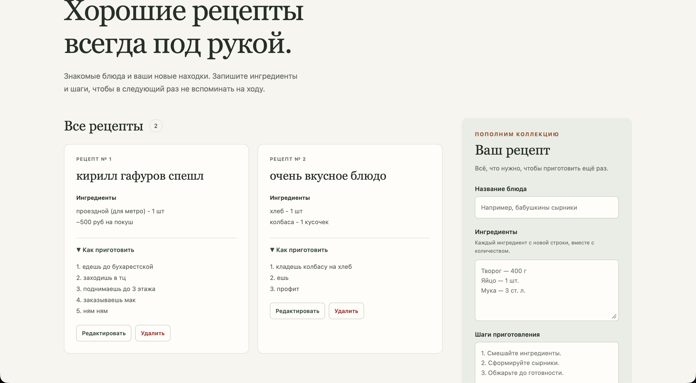
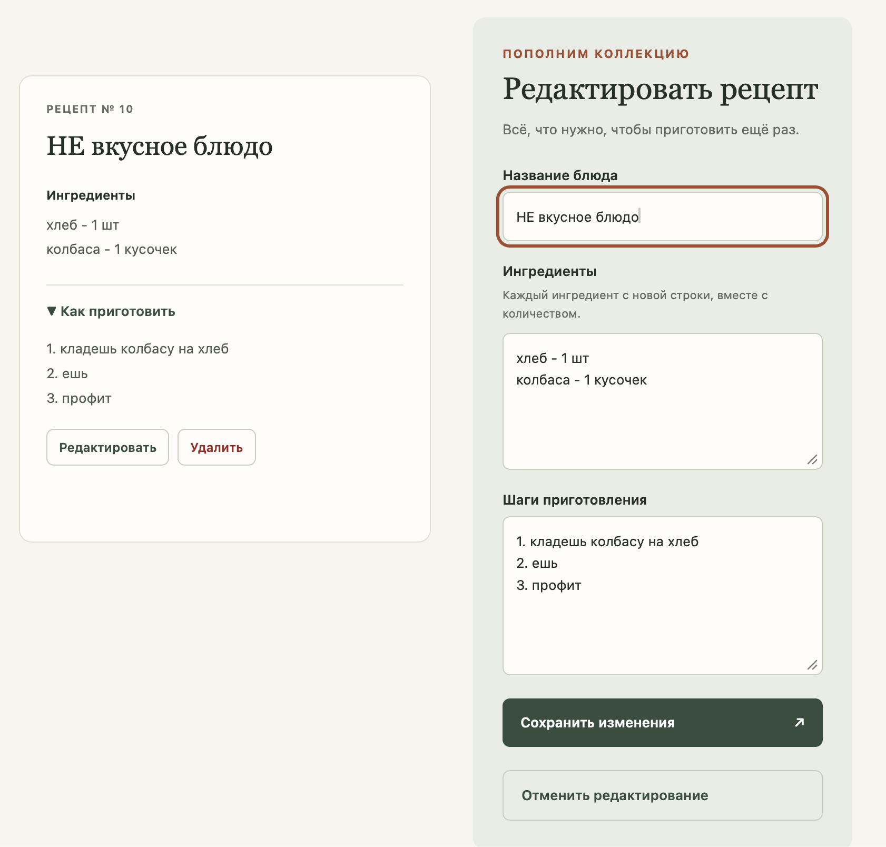
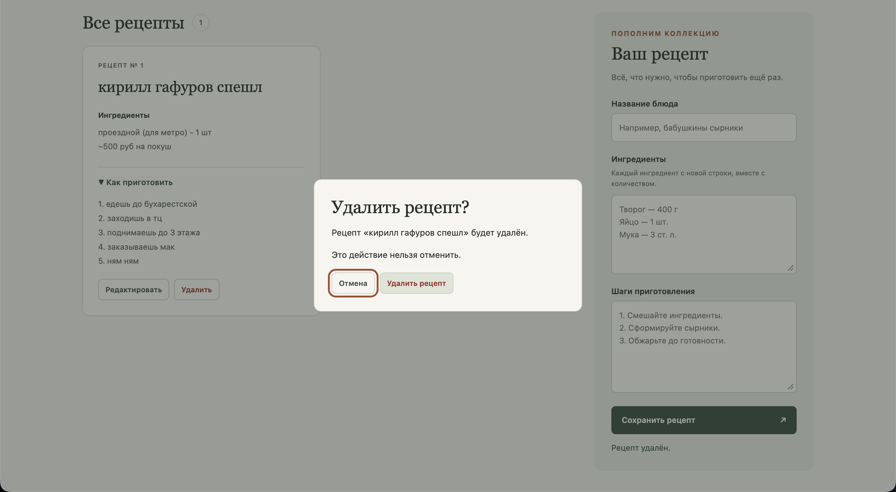

# Книга рецептов

Выполняли: Габдуллин Илья, Гафуров Кирилл, Воронко Кирилл

Для нулевой лабораторной мы сделали небольшой сервис, в котором можно сохранять рецепты. Не стали строить кулинарный нетфликс, все простенько. В первой версии можно посмотреть список, добавить блюдо, отредактировать его или удалить.

## СТЕК очень крутой стек
 Мы выбрали Python и Flask на сервере, MySQL для базы и обычные HTML, CSS и JavaScript для страницы. Фронт конечно же мы навайбкодили потому что мы не крутые дизайнеры а зашуганные программисты. Интерфейс загружается из Flask. JavaScript обращается к серверу через API и получает ответы в формате JSON.

## что у нас ваще происходит как все устроено

На странице у нас кароч есть список рецептов и форма. Когда пользователь сохраняет рецепт, JavaScript отправляет его название ингредиенты способ приготовления и тптптп на Flask-сервер. Flask проверяет данные и записывает их в MySQL. Когда открываешь страницу сервер получает записи из базы, а браузер показывает их в списке, поэтму рецепт остается после перезагрузки страницы.

Во Flask настроены четыре действия: `GET /api/recipes` получает список, `POST /api/recipes` добавляет запись, `PUT /api/recipes/<id>` сохраняет изменения, а `DELETE /api/recipes/<id>` удаляет рецепт. Команда `flask --app backend.app init-db` создаёт таблицу `recipes` с полями `id`, `title`, `ingredients` и `instructions`.

## чо мы вообще проверили (а мы проверяли очень жоско поверьте)

мы добавили несколько рецептов, обновили страницу и проверили, что записи остались. Потом попробовали изменить и удалить рецепт. При удалении страница просит подтверждение. Эти действия проверили работу формы, API и базы данных.

В ридмишке написано как установить все зависимости и правильно забилдить проект чтобы у вас тоже была очень крутая платформа для ваших рецептов!! 

Вот вам пару скриншотов где изображен функционал сайта

СПАсибо за внимание

